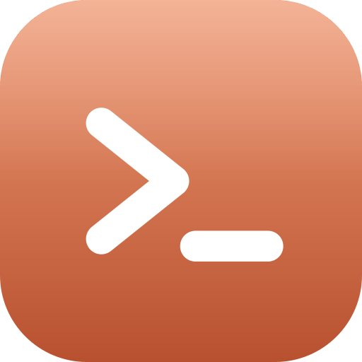
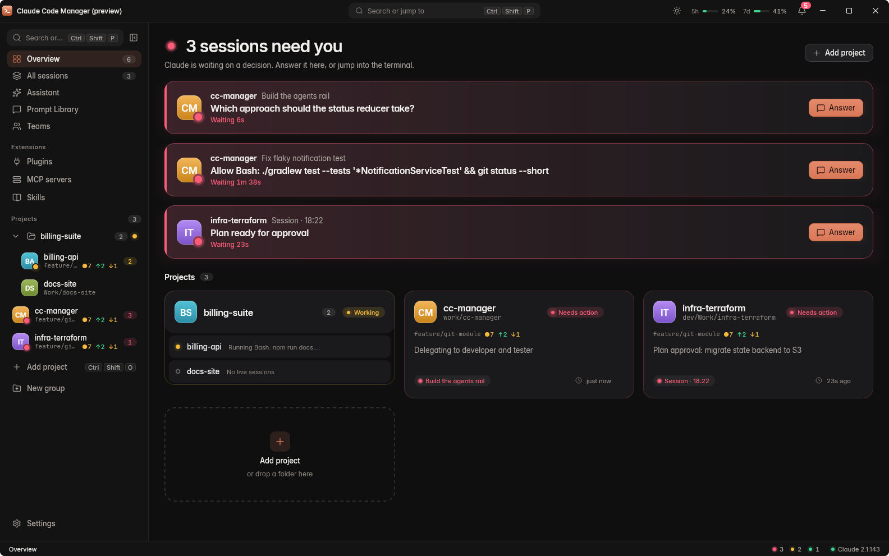
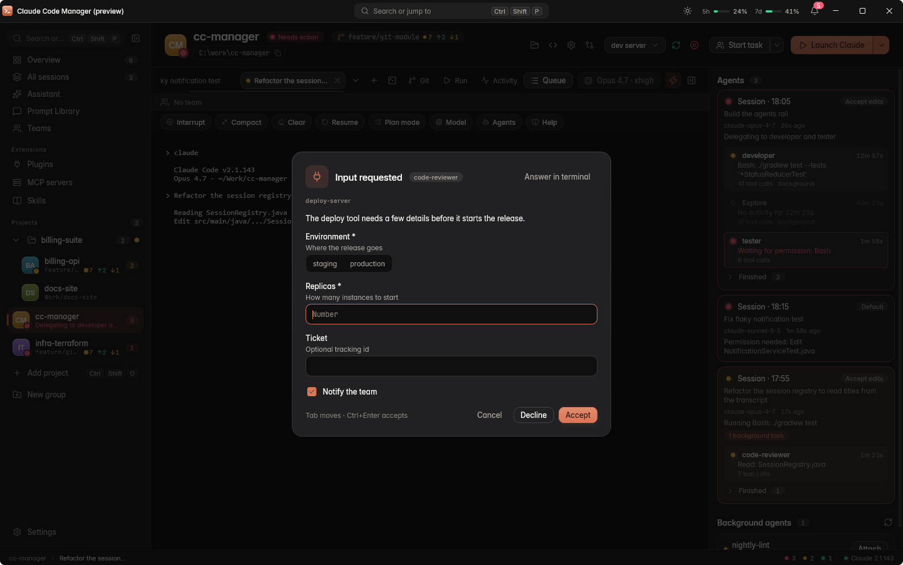
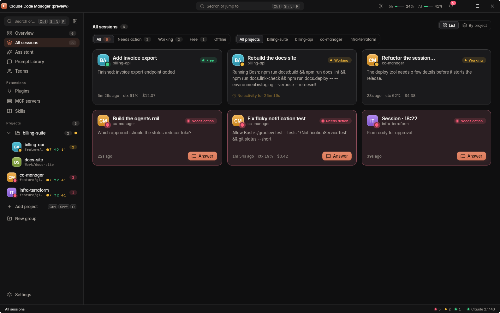
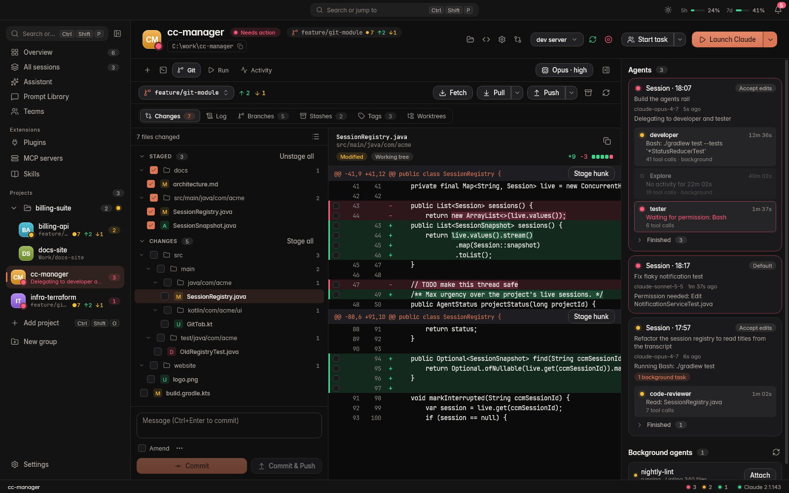
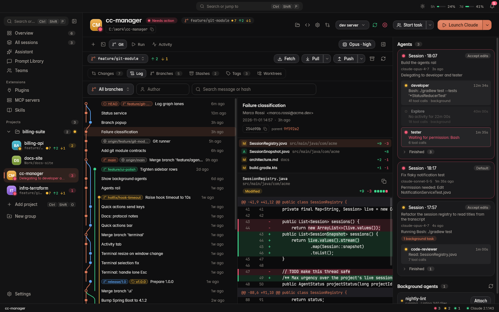
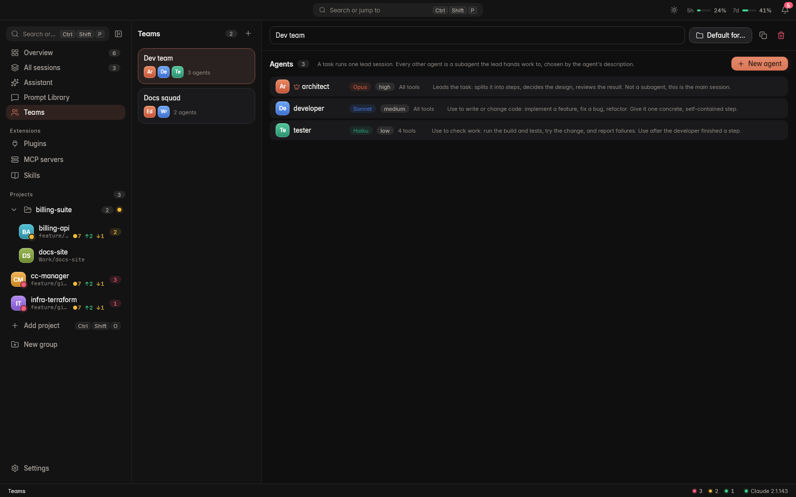
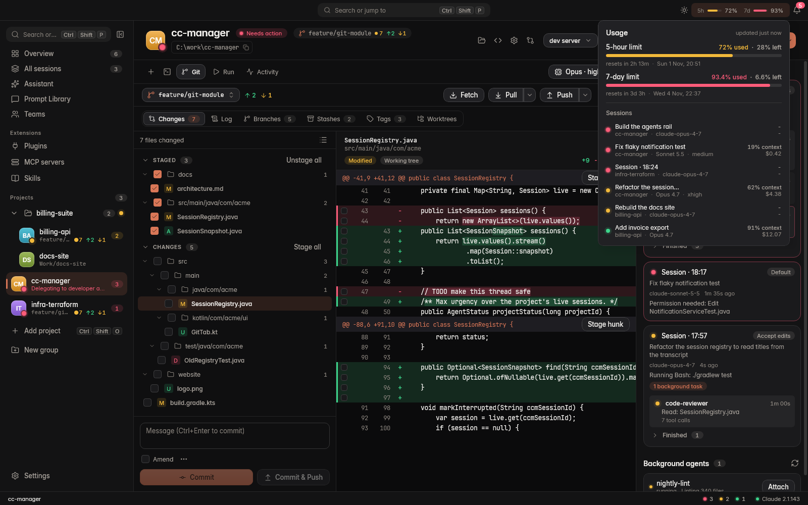
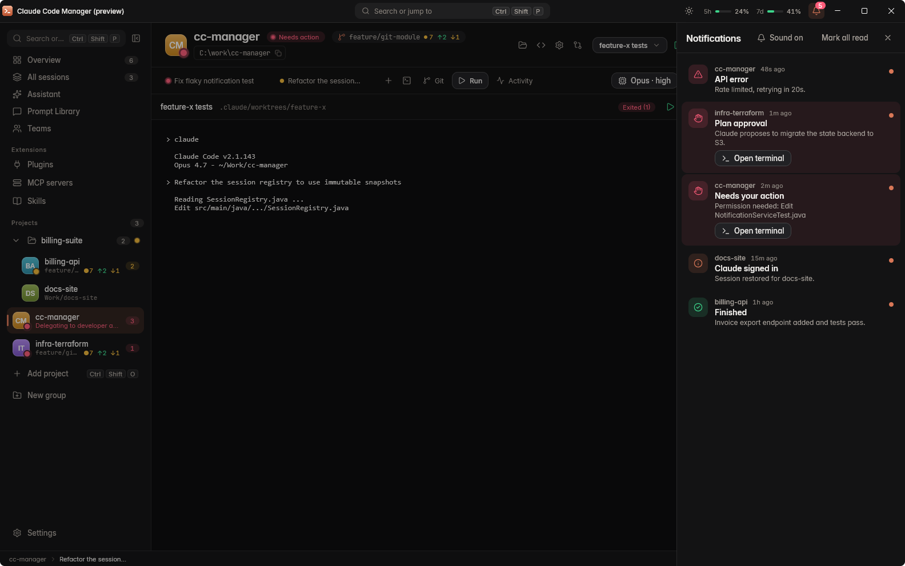
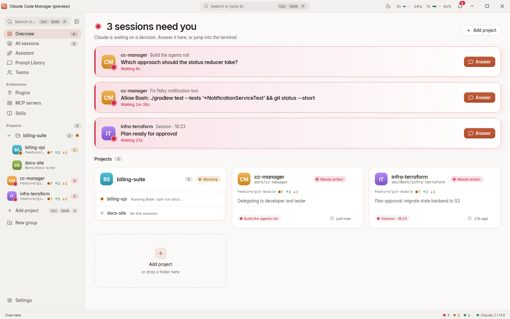

<div align="center">



# Claude Code Manager

**One desktop app to run, watch and steer many local Claude Code sessions.**

Projects, agent teams, notifications, and one-click approval of everything Claude asks for.

[](https://github.com/krpkbhdn/cc-manager/releases)


-orange)


**English** · [Українська](README.uk.md)

</div>



**Contents:** [Why](#why) · [Quick start](#quick-start) · [Features](#features) · [Screenshots](#screenshots) · [Requirements](#requirements) · [Install](#install) · [Build from source](#build-and-run-from-source) · [Shortcuts](#keyboard-shortcuts) · [Configuration](#configuration) · [Contributing](#contributing) · [License](#license)

## Why

Working with several Claude Code sessions means a pile of terminals, and you never know which one is waiting for you.
Claude Code Manager puts them in one window: every session shows its status, and every question, plan or permission request
becomes a dialog you can answer without hunting for the right terminal.

Everything runs **locally on your own Claude Code installation**. There is no server component and nothing proxies your sessions.

## Quick start

1. Install and log in to [Claude Code](https://code.claude.com/docs/en/overview).
2. Install Claude Code Manager (Windows: the `.msi` from [Releases](https://github.com/krpkbhdn/cc-manager/releases); Linux and macOS: [build the installer](#build-and-run-from-source)).
3. Start the app, press `Ctrl+Shift+O` to add a project folder, then `Ctrl+Shift+T` to start a Claude session in it.

When any session needs you, it turns red on the Overview and in the status bar; press `Ctrl+Shift+N` to answer the next one.

## Features

**Sessions**
- **Projects and sessions**: register project folders, start or resume Claude sessions in a real embedded terminal.
- **Live status**: every session is *idle*, *working* or *needs action*; the status bar, notifications and the "Sessions" screen show it at a glance.
- **Answer from the app**: questions, plan approvals, tool permissions and MCP forms open as modal dialogs. The terminal dialog stays live, and whichever answers first wins.
- **Plain shells**: PowerShell, cmd, Git Bash and WSL on Windows, your `$SHELL` elsewhere, as a tab next to Claude.

**Agents and automation**
- **Agent teams**: define roles (model, effort, tools) and start a lead that delegates to native subagents.
- **Assistant**: a Claude session outside any project that opens projects, starts sessions and drives the app through a dedicated MCP server.
- **Prompt library and queue**: reusable templates with placeholders, and a per-session queue that types the next prompt when a turn ends.
- **Run configurations**: start your app from the manager; Claude can register one for its own git worktree.

**Workspace**
- **Git tab**: changes with hunk-aware diff, commit, log graph, branches, stashes and tags.
- **Usage meters**: 5-hour and 7-day limits (Pro/Max plans only; Team plans get the per-session list instead) plus per-session model, context and cost.
- **Extensions**: manage plugins, marketplaces, MCP servers and skills.
- **Voice dictation** (experimental, Windows first): hold Space in the prompt, task and commit-message fields to dictate with a local Whisper model. Models are downloaded only when you ask.
- **Command palette and shortcuts** for almost everything.

## Screenshots


*Questions, plans and permissions open as dialogs, no need to find the terminal.*

| | |
|---|---|
| <br/>**Sessions** | <br/>**Git: changes** |
| <br/>**Git: log** | <br/>**Agent teams** |
| <br/>**Usage** | <br/>**Notifications** |

<details>
<summary>Light theme</summary>



</details>

> The screenshots are rendered from the built-in preview with fake data.

## Requirements

To use the app:

- [Claude Code](https://code.claude.com/docs/en/overview) (the native `claude` binary), installed and logged in.
- `git` on `PATH` for the Git tab.

To build from source:

- A JDK to start Gradle (17 or newer). The build downloads **JetBrains Runtime 25** itself through the Foojay resolver
  (about 670 MB, once). Nothing else to install.
- Packaging must run on the target OS: an installer for Windows is built on Windows, `.deb` on Linux, `.dmg` on macOS.

> Windows is the most tested platform. Linux and macOS builds are supported by the build but have had less testing.

## Install

### Windows

Download the `.msi` from the [Releases](https://github.com/krpkbhdn/cc-manager/releases) page, check it against the
published `.sha256` (`(Get-FileHash .\<installer>.msi).Hash`), and run it. It installs per user with a Start menu entry and a desktop shortcut.

> The installer is not code-signed, so Windows SmartScreen may warn. Choose *More info*, then *Run anyway*, after checking the hash.

### Linux

Build the `.deb` yourself (see below) and install it:

```sh
sudo apt install ./build/compose/binaries/main/deb/*.deb
```

### macOS

Build the `.dmg` yourself (see below), open it and drag the app to Applications.

## Build and run from source

```sh
git clone https://github.com/krpkbhdn/cc-manager.git
cd cc-manager
```

| Task | Windows (PowerShell) | Linux / macOS / Git Bash |
|---|---|---|
| Run the app | `.\gradlew.bat run` | `./gradlew run` |
| Tests | `.\gradlew.bat test` | `./gradlew test` |
| Compile, test, jar | `.\gradlew.bat build` | `./gradlew build` |
| Installer | `.\gradlew.bat packageMsi` (or `packageExe`) | `./gradlew packageDeb` (Linux), `./gradlew packageDmg` (macOS) |

Installers are written to `build/compose/binaries/main/<format>/`.

The first build needs internet: it downloads Gradle and JBR 25, so it takes a while. Without JBR the app falls back to the plain OS window frame; `-Dccm.nativeFrame=true` forces the native OS frame even on JBR.

## Keyboard shortcuts

<details>
<summary>Show all shortcuts</summary>

The table shows Windows and Linux chords. On macOS most of them use `Cmd` or `Cmd+Shift` instead (`Cmd+T`, `Cmd+O`, `Cmd+K`, `Cmd+1`..`9`, `Cmd+Shift+S/I/E/N/G/K/U/R/Y/M`); `Alt+F12` is unchanged.

| Action | Shortcut |
|---|---|
| Command palette | `Ctrl+Shift+P` |
| Shortcut sheet | `F1` or `Ctrl+Shift+/` |
| Add project | `Ctrl+Shift+O` |
| New Claude session | `Ctrl+Shift+T` |
| Sessions | `Ctrl+Shift+S` |
| Answer next waiting session | `Ctrl+Shift+N` |
| Assistant / ask the assistant | `Ctrl+Shift+I` / `Ctrl+Shift+E` |
| Git tab / commit / push | `Ctrl+Shift+G` / `Ctrl+Shift+K` / `Ctrl+Shift+U` |
| Run selected configuration | `Ctrl+Shift+R` |
| Usage | `Ctrl+Shift+Y` |
| Notifications | `Ctrl+Shift+M` |
| Open terminal | `Alt+F12` |
| Project 1-9 / Overview | `Alt+1`..`Alt+9` / `Alt+0` |

Plain `Ctrl+letter` chords go to the terminal, which is why the app uses `Ctrl+Shift`.

</details>

## Configuration

Data lives in `~/.cc-manager` (SQLite database `cc-manager.db`); change the location with the `cc-manager.data-dir` property.
Settings are `cc-manager.*` properties, see [`application.properties`](src/main/resources/application.properties).
The hooks and protocol reference is in [docs/claude-code-protocol.md](docs/claude-code-protocol.md).

## Contributing

Development happens on `develop`; `main` is stable. Run `./gradlew test` before opening a pull request.

## License

Licensed under the Apache License, Version 2.0 — see [LICENSE](LICENSE).

Copyright 2026 Bohdan Krupko
